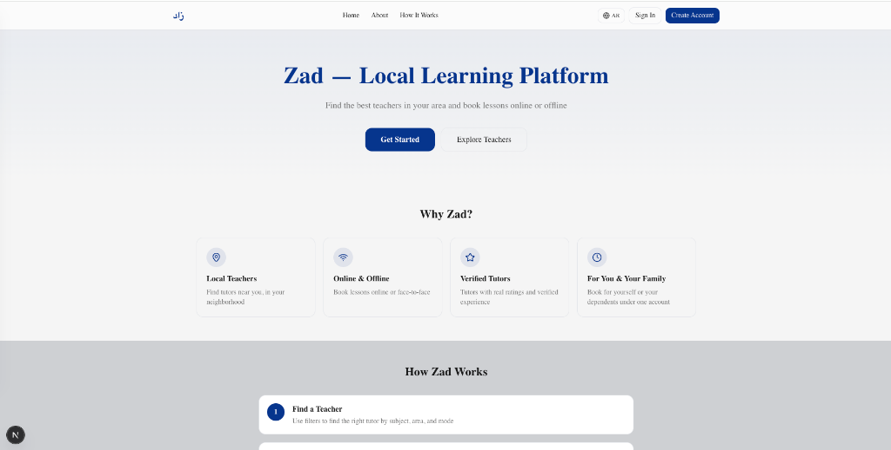
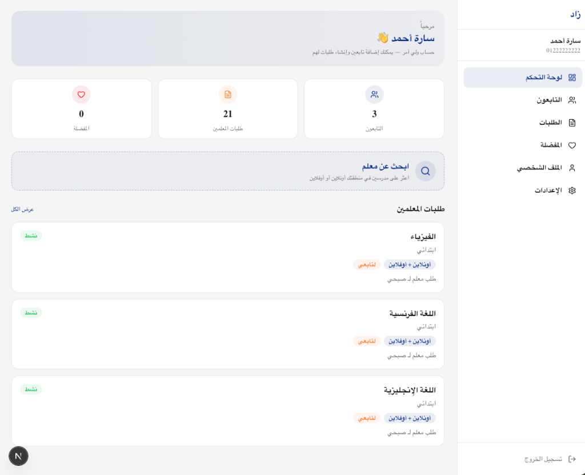
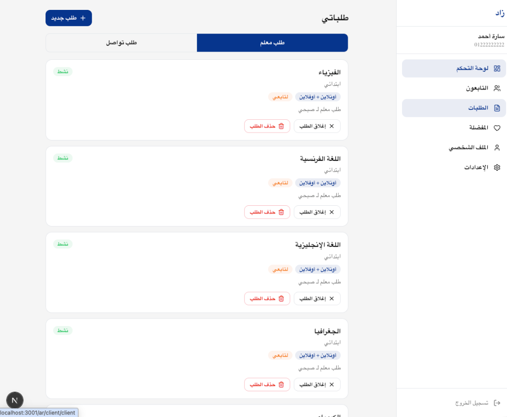
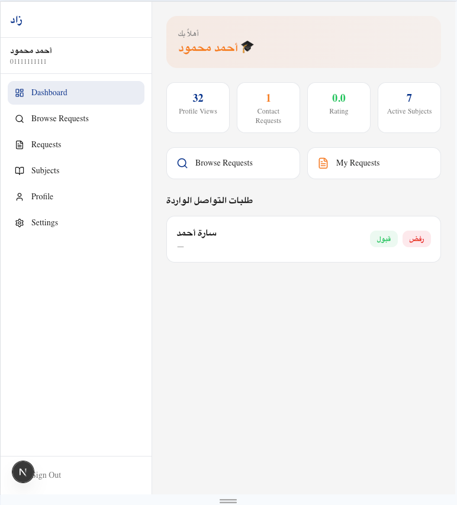

# Zads (زاد)

[](https://github.com/SayedEsmail/zads/actions/workflows/deploy-app.yml)
[](https://github.com/SayedEsmail/zads/actions/workflows/deploy-api.yml)

**Zads** is a local learning marketplace for Egypt: learners and parents find verified teachers in their own city and area, and agree directly on where the lesson happens (online, at home, at the teacher's place, or at a venue). Zero commission; the platform's job is discovery and safe first contact.

Live: **[zads.app](https://zads.app)** · API: `api.zads.app` · Arabic (RTL) and English.

This is the full source of a product I built and run solo, from a Nuxt 3 / Vuetify first version to the current Next.js 16 App Router app and Express/Prisma API, with CI deploys to Vercel. Product story, data contracts and the complete route map live in **[DOCUMENTATION.md](./DOCUMENTATION.md)**.

| | | 
|---|---|
|  |  |
|  |  |

---

## Repository layout

| Path | What it is | Stack |
|---|---|---|
| [`zads-app/`](./zads-app/) | Web app for visitors, clients (parents / self-learners), teachers and admins. ~14.5k lines TS/TSX, 42 routes. | Next.js 16 (App Router), React 19, TypeScript, Tailwind CSS 4, shadcn/ui, next-intl, Auth.js v5, CASL, Zustand, react-hook-form + zod, TanStack Table |
| [`zads-api/`](./zads-api/) | REST API. ~5k lines, 13 route modules, 9 Prisma migrations, 3 HTTP integration-test suites. | Node 20, Express, Prisma, PostgreSQL (Neon), firebase-admin (push), helmet, zod |
| [`legacy/`](./legacy/) | The Nuxt 3 / Vuetify public site and admin dashboard that `zads-app` replaced. Archived, read-only. | Vue 3, Nuxt 3, Vuetify 3 |
| [`docs/ai-workflow/`](./docs/ai-workflow/) | Briefs, reviews and hand-overs written for AI coding agents (see below). | |
| [`.github/workflows/`](./.github/workflows/) | Lint → build → test → deploy pipelines for app and API. | GitHub Actions, Vercel |

## Architecture

```
┌──────────────────────────────────────────────┐
│  zads-app  (Next.js 16 App Router, Vercel)   │
│  /[locale]/public · /client · /teacher       │
│  /admin   — next-intl (ar RTL / en)          │
│  Auth.js v5 (phone + password, JWT)          │
│  CASL ability per role · Zustand UI state    │
└───────────────┬──────────────────────────────┘
                │ same-origin /api proxy (proxy.ts) forwards the
                │ session JWT as a Bearer token — no CORS, no
                │ API origin exposed to the browser
                ▼
┌──────────────────────────────────────────────┐
│  zads-api  (Express on Vercel functions)     │
│  helmet · zod validation · role guards       │
│  privacy allowlist + phone masking           │
│  contact-request state machine · FCM push    │
└───────────────┬──────────────────────────────┘
                │ Prisma
                ▼
┌──────────────────────────────────────────────┐
│  PostgreSQL (Neon)                           │
└──────────────────────────────────────────────┘
```

Design points worth reading in the code:

- **Privacy by contract.** Teacher phone numbers are never returned to a client until a contact request is accepted; the API has an explicit response allowlist and a masking layer, and the privacy tests (`z04-z08-privacy-contracts.test.js`) assert it per endpoint.
- **Contact request state machine.** `pending → accepted | rejected`; phones stay `null` on both sides until acceptance, and contact creation is idempotent so a double-tap never creates two requests. See [Section 3 of the handbook](./DOCUMENTATION.md#section-3-privacy-security--data-contracts).
- **Egyptian phone normalisation** (`010…`, `+2010…`, `0020…` all resolve to one identity) at registration and login.
- **Localisation first.** Every route lives under `/[locale]`; `next-intl` drives messages, `dir="rtl"` and date/number formatting. `/test-rtl` is a visual RTL smoke page.

## Nuxt 3 → Next.js 16 migration: why and how

The first version (Jan 2026, `legacy/`) was two Nuxt 3 apps on Vuetify: a public site and an admin dashboard, ~35k lines including the template they were built on. It shipped, but three things pushed the rewrite:

1. **One app, three roles.** Visitor, client, teacher and admin flows were spread over two apps with duplicated auth, API clients and i18n. App Router layouts (`/[locale]/{public,client,teacher,admin}/layout.tsx`) gave one codebase with per-area shells and guards.
2. **RTL and i18n as a first-class routing concern.** Locale in the URL, `next-intl` message loading per segment and server-rendered `dir` removed a whole class of flash-of-wrong-direction bugs the Nuxt version had.
3. **Auth and authorisation.** Auth.js v5 with a phone/password credentials provider plus CASL abilities replaced hand-rolled route middleware. The Next app talks to the API through a same-origin proxy, so the browser never sees the API origin or a long-lived token.

How it was done (May–Sept 2026):

- Mapped every Nuxt page, layout, Pinia store and plugin to its App Router equivalent first; the mapping is in [`legacy/Transitioning from Vue to Next.js.md`](./legacy/Transitioning%20from%20Vue%20to%20Next.js.md) and was used as the checklist.
- Rebuilt feature by feature with the legacy app open as the behaviour reference, keeping the Express API unchanged where possible so both front-ends could run against it during the switch.
- Hardened the API in parallel (helmet, zod schemas, privacy allowlist, migrations instead of `db push`) and wrote the HTTP integration tests before the production cut-over.
- Moved API hosting from Render to Vercel functions and the database to Neon, with migrations run from CI.

The old apps stay in `legacy/` on purpose: they are the proof of the before/after, and the admin dashboard still documents a few flows not yet rebuilt.

## Running it locally

Prerequisites: Node 20+, pnpm 8+, PostgreSQL (or a Neon branch).

```bash
# 1. API
cd zads-api
pnpm install
cp .env.example .env            # set DATABASE_URL / DIRECT_URL / JWT_SECRET
pnpm run db:migrate              # prisma migrate dev
pnpm run db:seed                 # creates the admin user
pnpm run dev                     # http://localhost:3000/api

# 2. Web app
cd ../zads-app
pnpm install
cp .env.local.example .env.local # set AUTH_SECRET / NEXTAUTH_SECRET
pnpm run dev                     # http://localhost:3001 → /ar or /en
```

Seeded admin: phone `01000000000`, password `admin123`. Register teacher and client accounts through the UI.

Push notifications are optional: set `FIREBASE_SERVICE_ACCOUNT_JSON` (the service-account JSON as a string) or `GOOGLE_APPLICATION_CREDENTIALS` (a path to it). Without either, the API logs a warning and disables push.

## Tests

The API has three HTTP integration suites that exercise the real Express app against a **disposable embedded PostgreSQL** (no Docker, no shared database):

```bash
cd zads-api
pnpm run test:local
```

`scripts/test-local.js` starts `embedded-postgres` on a free port, runs `prisma migrate deploy`, then runs:

| Suite | Covers |
|---|---|
| `tests/e2e-complete-flow.test.js` | 10 scenarios: guest discovery allowlist, registration without PII in server events, true idempotency of contact requests (lost-response retry, changed payload, concurrency), recipient-only acceptance and phone unlock, certificate ownership and verification, password change, push-token registration with honest delivery status, teacher-initiated requests, search price-matching consistency |
| `tests/z03-admin-contracts.test.js` | Admin endpoints: 401 for unauthenticated calls, paginated teachers / parents / contact-request lists, contact stats contract |
| `tests/z04-z08-privacy-contracts.test.js` | Phone and certificate masking on public teacher search and details, search filters, contact-request state machine (409 on duplicate pending, initiator cannot accept, phones revealed to both sides only on `accepted`), teacher availability validation (HH:mm, ranges, overlaps) |

The same command runs in CI on every push that touches `zads-api/`, before the deploy job. Front-end checks in CI are `eslint` and a production `next build`.

## CI/CD

Two workflows, one per package, triggered by path filters:

- **zads-app**: install → lint → `next build` → deploy to Vercel (production) on `main`.
- **zads-api**: install → `prisma generate` → lint → `test:local` → deploy to Vercel on `main`.

Secrets (Vercel token / project ids, `NEXT_PUBLIC_API_URL`) live in GitHub Actions secrets and Vercel environment variables only. No credential of any kind is in this repository or its history.

## How I work with AI coding agents

Most of the Sept 2026 production-hardening round (privacy contracts, migration reconciliation, analytics funnel, push registration) was done with AI coding agents as pair programmers, and the artefacts are in [`docs/ai-workflow/`](./docs/ai-workflow/). The loop that worked:

1. **Write the brief, not the prompt.** `CODEX_IMPLEMENTATION_BRIEF.md` is a prioritised P0→P2 scope with explicit "do not invent scope" boundaries, acceptance checks and the product repositioning the copy had to follow.
2. **Have a second agent review the brief against the code before anyone implements it.** `ZADS_REVIEW_AND_EXECUTION_PLAN.md` separates proven bugs from observations about the deployed version from features that never existed, and reorders the priorities. This caught the most expensive mistakes early.
3. **Implement in small verified steps**; every claim of "done" needs a command whose output is in the hand-over (`tsc --noEmit`, `eslint`, `test:local`, production read checks).
4. **Hand over, don't restart.** `CURSOR_HANDOVER.md` tells the next session (human or agent) what is verified, what is open and what not to redo. `FINAL_REVIEW_FIX_SCOPE.md` is the closing review with a fixed R1–R8 fix list.

The repo also carries an `.agents/skills/` folder with a Neon/Postgres skill so agents get the same database conventions I follow.

## License

Source-available, all rights reserved. The code is published so it can be read and evaluated; it is not licensed for reuse, redistribution or commercial use without written permission. © 2026 Sayed Esmail.
