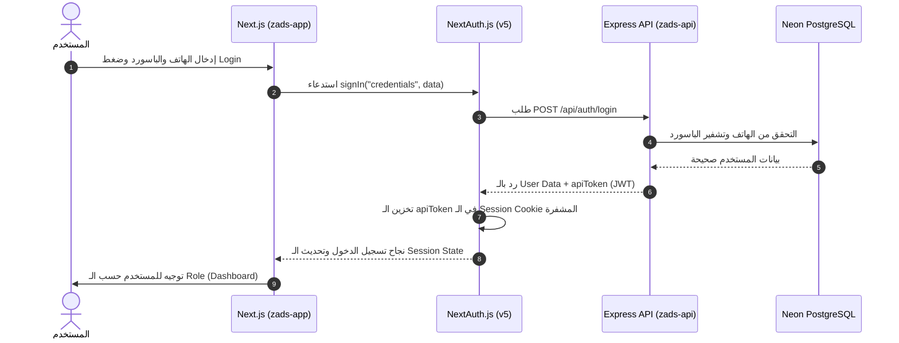

<div dir="rtl">
<style>
  pre, code, .mermaid {
    direction: ltr !important;
    text-align: left !important;
  }
  th, td {
    text-align: right !important;
  }
</style>

# 📗 خريطة تعلم Next.js و React — من مشروع Zads


> **المستوى:** من الصفر حتى فهم كامل لكود المشروع
> **الوقت المتوقع:** 4-6 أسابيع (ساعتين يومياً)
> **الطريقة:** كل موضوع فيه شرح + رابط لملف حقيقي من المشروع تروح تبص عليه

---

## 🗺️ الخريطة الكاملة

```
المرحلة 1: أساسيات React ← (أسبوع 1)
    │
    ▼
المرحلة 2: Next.js App Router ← (أسبوع 2)
    │
    ▼
المرحلة 3: التنسيق و المكونات ← (أسبوع 3)
    │
    ▼
المرحلة 4: إدارة الحالة و البيانات ← (أسبوع 3-4)
    │
    ▼
المرحلة 5: المصادقة والصلاحيات ← (أسبوع 4)
    │
    ▼
المرحلة 6: الترجمة و التدويل ← (أسبوع 5)
    │
    ▼
المرحلة 7: أنماط متقدمة ← (أسبوع 5-6)
```

---

---

## 📦 المرحلة 1: أساسيات React (قبل ما تبدأ Next.js)

> **الهدف:** تفهم React الأساسي — المكونات، الـ props، الـ state، والـ hooks.

### 1.1 ايه هو React؟

React هي مكتبة JavaScript لبناء واجهات المستخدم. الفكرة الأساسية:
- **المكونات (Components):** كل جزء من الصفحة هو مكون مستقل
- **JSX:** بتكتب HTML جوا JavaScript
- **الحالة (State):** البيانات اللى بتتغير وبتخلي الصفحة تتحدث

### 1.2 مكونات React — أمثلة من المشروع

#### المكون الأبسط (Functional Component):

```tsx
// مكون React بسيط — بياخد props وبيعرض UI
function TeacherCard({ teacher }) {
    return (
        <div>
            <h2>{teacher.name}</h2>
            <p>{teacher.bio}</p>
        </div>
    );
}
```

📄 **شوف المكونات دي من المشروع:**
- [TeacherCard](file:///Users/sayed/Devs/Zads/zads-app/src/components/shared/TeacherCard.tsx) — كارت المدرس (مكون مشترك بيتكرر في أكتر من صفحة)
- [ErrorBanner](file:///Users/sayed/Devs/Zads/zads-app/src/components/shared/ErrorBanner.tsx) — بانر الأخطاء
- [PageSkeleton](file:///Users/sayed/Devs/Zads/zads-app/src/components/shared/PageSkeleton.tsx) — هيكل التحميل

**لاحظ في الملفات:**
- `"use client"` في أول السطر → ده معناه المكون ده بيشتغل في المتصفح (Client Component)
- `import { useTranslations } from "next-intl"` → بيستخدم الترجمة
- `const t = useTranslations("namespace")` → بيجيب دالة الترجمة
- `t("key")` → بيترجم النص

### 1.3 الـ Hooks الأساسية في React

| Hook | الغرض | مثال من المشروع |
|------|-------|----------------|
| `useState` | تخزين بيانات متغيرة | أي form state |
| `useEffect` | تنفيذ كود عند تحميل الصفحة | جلب البيانات من الـ API |
| `useCallback` | تخزين دالة عشان مش تتعمل من جديد | Event handlers |
| `useMemo` | تخزين نتيجة حساب | فلترة البيانات |

📄 **روح شوف استخدام الـ hooks:**
- افتح أي صفحة في [client/](file:///Users/sayed/Devs/Zads/zads-app/src/app/[locale]/client) — هتلاقي `useEffect` لجلب البيانات
- افتح أي صفحة في [teacher/](file:///Users/sayed/Devs/Zads/zads-app/src/app/[locale]/teacher) — هتلاقي `useState` للـ forms

### 1.4 الـ Props و Children

```tsx
// Props = البيانات اللى بتتبعت للمكون
<Button variant="outline" size="sm" onClick={handleClick}>
    اضغط هنا
</Button>

// Children = اللى جوا الـ tag
<Card>
    <CardHeader>العنوان</CardHeader>  {/* ← children */}
    <CardContent>المحتوى</CardContent>
</Card>
```

📄 **شوف مكونات shadcn/ui:**
- [Button](file:///Users/sayed/Devs/Zads/zads-app/src/components/ui/button.tsx) — لاحظ كيف بياخد `variant` و `size` كـ props
- [Card](file:///Users/sayed/Devs/Zads/zads-app/src/components/ui/card.tsx) — لاحظ `CardHeader`, `CardContent`, `CardFooter` كمكونات فرعية

---

## 📦 المرحلة 2: Next.js App Router

> **الهدف:** تفهم ازاي Next.js بينظم الصفحات والـ routing.

### 2.1 ايه الفرق بين React و Next.js؟

| React (بدون Next.js) | Next.js |
|-----------------------|---------|
| صفحة واحدة (SPA) | صفحات متعددة (SSR + SSG) |
| لازم تعمل routing يدوي | File-based routing تلقائي |
| كل الكود في المتصفح | Server Components + Client Components |
| SEO صعب | SEO تلقائي |
| لازم تعمل API proxy يدوي | Rewrites + API Routes مدمجة |

### 2.2 File-Based Routing — الفكرة الأساسية

في Next.js، **مسار الملف = مسار الـ URL:**

```
src/app/[locale]/auth/login/page.tsx    →  /en/auth/login
src/app/[locale]/client/page.tsx        →  /en/client
src/app/[locale]/teacher/profile/page.tsx  →  /en/teacher/profile
src/app/[locale]/admin/teachers/page.tsx   →  /en/admin/teachers
```

**القواعد:**
- `page.tsx` → الصفحة الفعلية (لازم يكون اسمه `page`)
- `layout.tsx` → الإطار اللى بيلف الصفحة (navbar, sidebar)
- `[locale]` → Dynamic segment (متغير — ممكن يكون `en` أو `ar`)
- `loading.tsx` → صفحة التحميل (اختياري)
- `error.tsx` → صفحة الخطأ (اختياري)

📄 **شوف هيكل الصفحات:**
- [app/page.tsx](file:///Users/sayed/Devs/Zads/zads-app/src/app/page.tsx) — الصفحة الجذر (`/`) — بتعمل redirect لـ `/en/public`
- [app/[locale]/layout.tsx](file:///Users/sayed/Devs/Zads/zads-app/src/app/[locale]/layout.tsx) — الـ layout الأساسي لكل الصفحات

### 2.3 الـ Layouts — الإطارات المتداخلة

Next.js بيدعم **Nested Layouts** — يعني layout جوا layout:

```
RootLayout (src/app/layout.tsx)
  └── LocaleLayout (src/app/[locale]/layout.tsx)        ← HTML + Providers
       ├── PublicLayout (public/layout.tsx)              ← Navbar + Footer
       ├── AuthLayout (auth/layout.tsx)                  ← Centered card
       ├── ClientLayout (client/layout.tsx)              ← Sidebar
       ├── TeacherLayout (teacher/layout.tsx)            ← Sidebar
       └── AdminLayout (admin/layout.tsx)                ← Sidebar
```

📄 **شوف الـ layouts من المشروع:**
- [Root Layout](file:///Users/sayed/Devs/Zads/zads-app/src/app/layout.tsx) — أبسط layout (بيحمل `globals.css` وبيعرض `children`)
- [Locale Layout](file:///Users/sayed/Devs/Zads/zads-app/src/app/[locale]/layout.tsx) — **الأهم** — بيضيف:
  - `<html lang={locale} dir={rtl|ltr}>` — اتجاه الصفحة
  - `SessionProvider` — يخلي الـ auth متاح في كل مكان
  - `NextIntlClientProvider` — يخلي الترجمة متاحة في كل مكان
  - `Toaster` — إشعارات
- [Client Layout](file:///Users/sayed/Devs/Zads/zads-app/src/app/[locale]/client/layout.tsx) — بيضيف الـ Sidebar الخاص بالعميل
- [Admin Layout](file:///Users/sayed/Devs/Zads/zads-app/src/app/[locale]/admin/layout.tsx) — بيضيف الـ Sidebar الخاص بالأدمن

**لاحظ النمط:**
```tsx
// layout.tsx نموذجي
export default function ClientLayout({ children }) {
    return (
        <div className="flex">
            <DashboardSidebar role="client" />
            <main className="flex-1">{children}</main>
        </div>
    );
}
```

### 2.4 Server Components vs Client Components

> **ده من أهم المفاهيم في Next.js الحديث!**

| Server Component | Client Component |
|-----------------|-----------------|
| **الافتراضي** — كل ملف server إلا لو قلت غير كده | لازم تكتب `"use client"` في أول السطر |
| بيشتغل على السيرفر فقط | بيشتغل في المتصفح |
| مش بيوصل للمتصفح (أقل JavaScript) | بيوصل كاملاً للمتصفح |
| مش بيقدر يستخدم `useState`, `useEffect` | بيقدر يستخدم كل الـ hooks |
| ممكن يعمل `async` ويجيب بيانات مباشرة | لازم يستخدم `useEffect` أو store |

📄 **شوف الفرق في المشروع:**
- [public/page.tsx](file:///Users/sayed/Devs/Zads/zads-app/src/app/[locale]/public/page.tsx) — **Server Component** (مفيش `"use client"`) — صفحة عامة
- [client/page.tsx](file:///Users/sayed/Devs/Zads/zads-app/src/app/[locale]/client/page.tsx) — **Client Component** (`"use client"`) — لوحة العميل (فيها `useEffect`, `useState`)

### 2.5 Dynamic Routes — المسارات الديناميكية

```
[locale]  → ده dynamic segment — بيتغير حسب اللغة
           /en/... أو /ar/...
```

في المشروع بنستخدم `[locale]` كـ dynamic parameter عشان نحدد اللغة. Next.js بيقرأ القيمة من الـ URL ويبعتها كـ param.

📄 **شوف ازاي بنستخدمه:**
- [routing.ts](file:///Users/sayed/Devs/Zads/zads-app/src/i18n/routing.ts) — تعريف اللغات المدعومة

### 2.6 API Routes في Next.js

Next.js بيسمحلك تعمل API endpoints جوا التطبيق نفسه:

```
src/app/api/auth/[...nextauth]/route.ts   →  /api/auth/*     (NextAuth بس)
src/app/api/[...backend]/route.ts         →  /api/*         (بروكسي Express)
```

📄 **شوف في المشروع:**
- `zads-app/src/app/api/auth/[...nextauth]/route.ts` — بيانات الدخول وجلسة NextAuth.
- `zads-app/src/app/api/[...backend]/route.ts` — بيمرر باقي نداءات `/api/*` لـ Express. بيشيل كوكي الجلسة وهيدرز Helmet والضغط من الرد.

> **ملاحظة:** بروكسي الـ API هو الـ route handler ده. `next.config.ts` مبقاش بيعمل rewrite لـ `/api/*`.

### 2.7 Next.js Config — إعدادات المشروع

📄 **شوف الإعدادات:**
- `zads-app/next.config.ts` — لاحظ:
  - `redirects()` — المسارات القديمة (`/parent` → `/client`، وصفحات التسويق → `/public`).
  - `images.remotePatterns` — السماح بتحميل صور من سيرفر الـ API.
  - `createNextIntlPlugin` — تفعيل الترجمة.
  - بروكسي الـ API في `src/app/api/[...backend]/route.ts`، مش هنا.

---

## 📦 المرحلة 3: التنسيق والمكونات (Styling & Components)

> **الهدف:** تفهم Tailwind CSS + shadcn/ui وازاي بنبني الواجهات.

### 3.1 Tailwind CSS — أساسيات

Tailwind هو **Utility-first CSS framework** — بدل ما تكتب CSS في ملفات منفصلة، بتستخدم classes جاهزة:

```html
<!-- CSS تقليدي -->
<div style="display: flex; gap: 16px; padding: 8px; background: blue;">

<!-- Tailwind -->
<div className="flex gap-4 p-2 bg-blue-500">
```

**أهم الـ utilities:**
| Category | Examples | المعنى |
|----------|---------|--------|
| Layout | `flex`, `grid`, `block` | نوع العرض |
| Spacing | `p-4`, `m-2`, `gap-3` | padding, margin, gap |
| Sizing | `w-full`, `h-screen`, `max-w-md` | عرض وارتفاع |
| Colors | `bg-primary`, `text-white` | خلفية ولون نص |
| Typography | `text-lg`, `font-bold` | حجم ونوع الخط |
| Responsive | `md:flex`, `lg:grid-cols-3` | حسب حجم الشاشة |
| Dark Mode | `dark:bg-gray-900` | الوضع الداكن |

📄 **شوف التنسيقات العامة:**
- [globals.css](file:///Users/sayed/Devs/Zads/zads-app/src/app/globals.css) — لاحظ:
  - `@theme inline` — تعريف الألوان الأساسية (Primary: `#06358d`, Secondary: `#f68023`)
  - CSS variables لـ shadcn (light + dark modes)
  - `--radius: 1.25rem` — زوايا مدورة كبيرة

### 3.2 shadcn/ui — مكونات جاهزة

shadcn/ui مش library عادية — هو **collection of copy-paste components** بتنزلها في مشروعك وتعدل عليها.

📄 **شوف المكونات المستخدمة:**
- [button.tsx](file:///Users/sayed/Devs/Zads/zads-app/src/components/ui/button.tsx) — زرار (variants: default, destructive, outline, ghost)
- [card.tsx](file:///Users/sayed/Devs/Zads/zads-app/src/components/ui/card.tsx) — كارت (header, content, footer)
- [dialog.tsx](file:///Users/sayed/Devs/Zads/zads-app/src/components/ui/dialog.tsx) — نافذة منبثقة
- [input.tsx](file:///Users/sayed/Devs/Zads/zads-app/src/components/ui/input.tsx) — حقل إدخال
- [select.tsx](file:///Users/sayed/Devs/Zads/zads-app/src/components/ui/select.tsx) — قائمة منسدلة
- [table.tsx](file:///Users/sayed/Devs/Zads/zads-app/src/components/ui/table.tsx) — جدول
- [tabs.tsx](file:///Users/sayed/Devs/Zads/zads-app/src/components/ui/tabs.tsx) — تبويبات
- [sheet.tsx](file:///Users/sayed/Devs/Zads/zads-app/src/components/ui/sheet.tsx) — لوحة جانبية

**لاحظ النمط في كل مكون:**
```tsx
// 1. بيستخدم cva (class-variance-authority) لتعريف variants
const buttonVariants = cva("base-classes", {
    variants: {
        variant: { default: "...", outline: "..." },
        size: { default: "...", sm: "...", lg: "..." },
    },
});

// 2. بياخد props + ref (forwardRef)
const Button = React.forwardRef(({ variant, size, ...props }, ref) => (
    <button className={cn(buttonVariants({ variant, size }))} ref={ref} {...props} />
));
```

📄 **شوف إعدادات shadcn:**
- [components.json](file:///Users/sayed/Devs/Zads/zads-app/components.json) — الإعدادات (style: base-nova, RSC: true)

### 3.3 الـ `cn()` Utility — دمج الـ classes

```ts
// src/lib/utils.ts
import { clsx } from "clsx";
import { twMerge } from "tailwind-merge";

export function cn(...inputs) {
    return twMerge(clsx(inputs));
}
```

**ليه مهمة؟** بتسمح تدمج classes بذكاء:
```tsx
cn("p-4 bg-blue-500", isActive && "bg-green-500")
// لو isActive = true → "p-4 bg-green-500" (twMerge بيشيل التكرار)
```

📄 **شوف:**
- [utils.ts](file:///Users/sayed/Devs/Zads/zads-app/src/lib/utils.ts) — `cn()` + `formatPrice()` + `getInitials()` + `extractError()`

### 3.4 مكونات Layout — Navbar و Sidebar

📄 **شوف المكونات الهيكلية:**
- [Navbar](file:///Users/sayed/Devs/Zads/zads-app/src/components/layout/Navbar.tsx) — شريط التنقل العلوي
- [Footer](file:///Users/sayed/Devs/Zads/zads-app/src/components/layout/Footer.tsx) — الذيل
- [DashboardSidebar](file:///Users/sayed/Devs/Zads/zads-app/src/components/layout/DashboardSidebar.tsx) — الـ sidebar المشترك (بياخد `role` prop ويعرض قوائم مختلفة)

**لاحظ في DashboardSidebar:**
- بياخد `role` prop (`"client"` | `"teacher"` | `"admin"`)
- بيعرض قوائم مختلفة حسب الـ role
- بيستخدم `usePathname()` عشان يحدد الصفحة الحالية (active state)
- بيستخدم `useTranslations()` عشان النصوص مترجمة

---

## 📦 المرحلة 4: إدارة الحالة والبيانات (State Management)

> **الهدف:** تفهم Zustand وازاي بنجيب ونخزن البيانات.

### 4.1 ايه هو Zustand؟

Zustand هو **state management library** بسيط جداً — بديل خفيف لـ Redux:

```ts
// Redux → كتير من الكود (actions, reducers, selectors, dispatch)
// Zustand → 10 سطور وخلاص ✅
```

### 4.2 النمط المستخدم في المشروع (Convention)

كل store في المشروع بيتبع نفس النمط:

📄 **شوف الـ convention أولاً:**
- [_convention.ts](file:///Users/sayed/Devs/Zads/zads-app/src/stores/_convention.ts) — **اقرأ ده أول حاجة** — فيه:
  - `StoreSlice<T>` — الـ interface المشترك لكل slice
  - `initialSlice<T>()` — القيم الافتراضية
  - `extractError()` — التعامل مع الأخطاء

**النمط الأساسي:**
```ts
interface MyStore {
    data: Item[];
    isLoading: boolean;
    error: string | null;
    fetch: () => Promise<void>;
    reset: () => void;
}

const useMyStore = create<MyStore>((set) => ({
    data: [],
    isLoading: false,
    error: null,

    fetch: async () => {
        set({ isLoading: true, error: null });
        try {
            const res = await apiGet<Item[]>("/api/items");
            set({ data: res.data, isLoading: false });
        } catch (err) {
            set({ error: extractError(err), isLoading: false });
        }
    },

    reset: () => set({ data: [], isLoading: false, error: null }),
}));
```

### 4.3 الـ Stores في المشروع — كل واحد وظيفته

📄 **شوف كل store بالترتيب:**

#### الأساسيات:
- [auth.ts](file:///Users/sayed/Devs/Zads/zads-app/src/stores/auth.ts) — **ابدأ بده** — تسجيل دخول، حساب جديد، تحديث الملف الشخصي
- [search.ts](file:///Users/sayed/Devs/Zads/zads-app/src/stores/search.ts) — البحث عن مدرسين (فيه pagination + filters)

#### العميل (Client):
- [client.ts](file:///Users/sayed/Devs/Zads/zads-app/src/stores/client.ts) — ملف العميل
- [dependents.ts](file:///Users/sayed/Devs/Zads/zads-app/src/stores/dependents.ts) — إدارة الأولاد (CRUD)
- [favorites.ts](file:///Users/sayed/Devs/Zads/zads-app/src/stores/favorites.ts) — المفضلة

#### المدرس (Teacher):
- [teacher.ts](file:///Users/sayed/Devs/Zads/zads-app/src/stores/teacher.ts) — ملف المدرس
- [teacher-subjects.ts](file:///Users/sayed/Devs/Zads/zads-app/src/stores/teacher-subjects.ts) — مواد المدرس وأسعاره
- [teacher-availability.ts](file:///Users/sayed/Devs/Zads/zads-app/src/stores/teacher-availability.ts) — مواعيد المدرس

#### مشترك:
- [contact-requests.ts](file:///Users/sayed/Devs/Zads/zads-app/src/stores/contact-requests.ts) — طلبات التواصل
- [tutor-requests.ts](file:///Users/sayed/Devs/Zads/zads-app/src/stores/tutor-requests.ts) — طلبات الدروس

#### الأدمن:
- [admin.ts](file:///Users/sayed/Devs/Zads/zads-app/src/stores/admin.ts) — **الأكبر** — كل وظائف لوحة الأدمن

### 4.4 ازاي الصفحة بتستخدم الـ Store؟

**النمط المتكرر في كل صفحة:**

```tsx
"use client";

export default function FavoritesPage() {
    const { favorites, isLoading, error, fetchFavorites } = useFavoritesStore();
    const t = useTranslations("favorites");

    // 1. جلب البيانات عند تحميل الصفحة
    useEffect(() => {
        fetchFavorites();
    }, []);

    // 2. حالة التحميل
    if (isLoading) return <PageSkeleton />;

    // 3. حالة الخطأ
    if (error) return <ErrorBanner message={error} />;

    // 4. عرض البيانات
    return (
        <div>
            <h1>{t("title")}</h1>
            {favorites.map(fav => <TeacherCard key={fav.id} teacher={fav} />)}
        </div>
    );
}
```

📄 **شوف أمثلة حقيقية:**
- [client/favorites/page.tsx](file:///Users/sayed/Devs/Zads/zads-app/src/app/[locale]/client/favorites/page.tsx) — صفحة المفضلة
- [client/dependents/page.tsx](file:///Users/sayed/Devs/Zads/zads-app/src/app/[locale]/client/dependents/page.tsx) — صفحة الأولاد
- [teacher/subjects/page.tsx](file:///Users/sayed/Devs/Zads/zads-app/src/app/[locale]/teacher/subjects/page.tsx) — صفحة مواد المدرس

### 4.5 الـ API Client — Axios

📄 **شوف:**
- [api.ts](file:///Users/sayed/Devs/Zads/zads-app/src/lib/api.ts) — Axios instance

**النقاط المهمة:**
```ts
// 1. Base URL نسبي — Next.js بيعمل proxy
const api = axios.create({ baseURL: "/api" });

// 2. Request interceptor — بيضيف الـ token تلقائياً
api.interceptors.request.use(async (config) => {
    const session = await getSession();
    if (session?.apiToken) {
        config.headers.Authorization = `Bearer ${session.apiToken}`;
    }
    return config;
});

// 3. Response interceptor — لو 401 بيعمل sign out
api.interceptors.response.use(
    (response) => response,
    (error) => {
        if (error.response?.status === 401) signOut();
        return Promise.reject(error);
    }
);

// 4. Typed helpers
export const apiGet = <T>(url) => api.get<ApiResponse<T>>(url);
export const apiPost = <T>(url, data) => api.post<ApiResponse<T>>(url, data);
```

---

## 📦 المرحلة 5: المصادقة والصلاحيات (Auth & Permissions)

> **الهدف:** تفهم ازاي المستخدم بيسجل دخول وايه اللى بيحصل ورا الكواليس.

### 5.1 تدفق المصادقة (Auth Flow)

```
┌─────────────┐     ┌──────────────┐     ┌──────────────┐
│  Login Form │ ──→ │  NextAuth    │ ──→ │  Express API │
│  (React)    │     │  (signIn())  │     │  /api/auth/  │
│             │     │              │     │   login      │
└─────────────┘     └──────┬───────┘     └──────┬───────┘
                           │                     │
                    JWT token ←──── apiToken ─────┘
                           │
                    Session (cookie) ←── stored in browser
                           │
                    كل طلب API → Bearer token تلقائياً
```

#### 🔄 رسم تسلسلي لتدفق المصادقة (NextAuth v5 + Express API JWT Handshake):




📄 **شوف الملفات بالترتيب:**

**1. صفحة تسجيل الدخول:**
- [auth/login/page.tsx](file:///Users/sayed/Devs/Zads/zads-app/src/app/[locale]/auth/login/page.tsx) — الفورم + `signIn("credentials", ...)`

**2. إعدادات NextAuth:**
- [auth.ts](file:///Users/sayed/Devs/Zads/zads-app/src/lib/auth.ts) — **ملف مهم جداً** — فيه:
  - `CredentialsProvider` — بيبعت phone/password لـ Express API
  - `jwt callback` — بيخزن `apiToken`, `userType`, `phone` في الـ JWT
  - `session callback` — بيخلي البيانات متاحة في `useSession()`

**3. NextAuth API Route:**
- [route.ts](file:///Users/sayed/Devs/Zads/zads-app/src/app/api/auth/[...nextauth]/route.ts) — catch-all route

**4. استخدام الـ session في الصفحات:**
```tsx
const { data: session } = useSession();
// session.user.userType → "teacher" | "parent" | "admin"
// session.apiToken → JWT token من Express
```

### 5.2 الصلاحيات (CASL)

📄 **شوف:**
- [ability.tsx](file:///Users/sayed/Devs/Zads/zads-app/src/lib/ability.tsx) — تعريف الصلاحيات

**الفكرة:** بناءً على `userType`، بنحدد ايه اللى المستخدم يقدر يعمله:

| الدور | الصلاحيات |
|-------|----------|
| `admin` | كل حاجة (`manage all`) |
| `parent` | إدارة الأولاد، الطلبات، المفضلة، قراءة المدرسين |
| `teacher` | إدارة المواد، طلبات التواصل، قراءة الطلبات |

### 5.3 حماية المسارات — `src/proxy.ts`

Next.js 16 بيشغّل `src/proxy.ts` قبل ما الصفحة تترندر. الملف بيصدّر `proxy` و `config`. مفيش `middleware.ts` منفصل.

📄 **شوف:** `zads-app/src/proxy.ts`

```ts
const PROTECTED = [
    { pattern: /^\/[^/]+\/client(\/.*)?$/, role: "parent" },
    { pattern: /^\/[^/]+\/teacher(\/.*)?$/, role: "teacher" },
    { pattern: /^\/[^/]+\/admin(?!\/login)(\/.*)?$/, role: "admin" },
];
// مش مسجّل → /{locale}/auth/login
// الرول غلط → الصفحة الرئيسية للرول (/client أو /teacher أو /admin)
```

كمان بيتخطى `/api` والملفات الثابتة، وبيظبط المسارات المكررة زي `/client/client`، وبيحوّل روابط `/parent` القديمة، وبعدين يسلّم الطلب لـ next-intl.


---

## 📦 المرحلة 6: الترجمة والتدويل (i18n)

> **الهدف:** تفهم ازاي بنخلي التطبيق يشتغل بالعربي والإنجليزي.

### 6.1 الهيكل

```
src/i18n/
├── routing.ts      ← تعريف اللغات: ['en', 'ar'], default: 'ar'
├── request.ts      ← تحميل ملف اللغة على السيرفر
└── locales/
    ├── ar.json     ← النصوص العربية (~16KB)
    └── en.json     ← النصوص الإنجليزية (~12KB)
```

📄 **شوف الملفات:**
- [routing.ts](file:///Users/sayed/Devs/Zads/zads-app/src/i18n/routing.ts) — إعدادات اللغات
- [request.ts](file:///Users/sayed/Devs/Zads/zads-app/src/i18n/request.ts) — تحميل الترجمة
- [ar.json](file:///Users/sayed/Devs/Zads/zads-app/src/i18n/locales/ar.json) — الترجمة العربية
- [en.json](file:///Users/sayed/Devs/Zads/zads-app/src/i18n/locales/en.json) — الترجمة الإنجليزية

### 6.2 ازاي بنستخدم الترجمة؟

```tsx
// في أي مكون
const t = useTranslations("client.dashboard");

// في الـ template
<h1>{t("title")}</h1>        // → "لوحة التحكم" أو "Dashboard"
<p>{t("welcome")}</p>        // → "مرحباً" أو "Welcome"
```

### 6.3 RTL Support — دعم العربي

```tsx
// في LocaleLayout
<html lang={locale} dir={locale === "ar" ? "rtl" : "ltr"}>
```

**Tailwind بيدعم RTL تلقائياً** عبر logical properties:
```html
<div className="ms-4">  <!-- margin-start: في LTR = margin-left, في RTL = margin-right -->
<div className="me-4">  <!-- margin-end: العكس -->
<div className="text-start">  <!-- text-align حسب الاتجاه -->
```

---

## 📦 المرحلة 7: أنماط متقدمة

> **الهدف:** تفهم الأنماط الاحترافية المستخدمة في المشروع.

### 7.1 TypeScript Types

📄 **شوف:**
- [types/index.ts](file:///Users/sayed/Devs/Zads/zads-app/src/types/index.ts) — **كل الـ types** (278 سطر, 25+ type)

**لاحظ:** الـ types بتطابق الـ Prisma models من الـ backend:
```ts
interface Teacher {
    id: string;
    userId: string;
    bio: string | null;
    experienceYears: number | null;
    // ... mirrors Prisma schema
}
```

### 7.2 Data Table Pattern — جداول البيانات

📄 **شوف:**
- [DataTable](file:///Users/sayed/Devs/Zads/zads-app/src/components/admin/DataTable.tsx) — جدول بيانات متقدم

**بيستخدم `@tanstack/react-table`:**
- Sorting (ترتيب)
- Filtering (فلترة)
- Pagination (صفحات)
- Responsive: جدول على الديسكتوب + كاردات على الموبايل

📄 **شوف استخدامه:**
- [admin/teachers/page.tsx](file:///Users/sayed/Devs/Zads/zads-app/src/app/[locale]/admin/teachers/page.tsx) — جدول المدرسين
- [admin/parents/page.tsx](file:///Users/sayed/Devs/Zads/zads-app/src/app/[locale]/admin/parents/page.tsx) — جدول الأولياء

### 7.3 Form Pattern — النماذج

**الأدوات:**
- `react-hook-form` — إدارة الفورم
- `zod` — تعريف schema للتحقق
- `@hookform/resolvers/zod` — ربط الاتنين ببعض

```tsx
const schema = z.object({
    phone: z.string().regex(/^(\+20|0)?1[0125][0-9]{8}$/),
    password: z.string().min(6),
});

const { register, handleSubmit, formState: { errors } } = useForm({
    resolver: zodResolver(schema),
});
```

📄 **شوف الفورمات:**
- [auth/login/page.tsx](file:///Users/sayed/Devs/Zads/zads-app/src/app/[locale]/auth/login/page.tsx) — فورم تسجيل الدخول
- [auth/register/page.tsx](file:///Users/sayed/Devs/Zads/zads-app/src/app/[locale]/auth/register/page.tsx) — فورم إنشاء حساب

### 7.4 Dark Mode — الوضع الداكن

**الأدوات:** `next-themes`

```tsx
// في أي مكون
const { theme, setTheme } = useTheme();

// التبديل
<Button onClick={() => setTheme(theme === "dark" ? "light" : "dark")}>
    Toggle Theme
</Button>
```

**CSS Variables بتتغير تلقائياً:**
```css
/* Light */
:root { --background: oklch(1 0 0); }

/* Dark */
.dark { --background: oklch(0.145 0 0); }
```

📄 **شوف التعريفات في:**
- [globals.css](file:///Users/sayed/Devs/Zads/zads-app/src/app/globals.css) — `@custom-variant dark` + CSS variables

---

## ✅ تمارين عملية (اختبر نفسك)

### تمرين 1: تتبع مسار صفحة
1. افتح [client/favorites/page.tsx](file:///Users/sayed/Devs/Zads/zads-app/src/app/[locale]/client/favorites/page.tsx)
2. شوف ازاي بتجيب البيانات (أي store بتستخدم؟)
3. روح للـ [favorites store](file:///Users/sayed/Devs/Zads/zads-app/src/stores/favorites.ts)
4. شوف ايه الـ API endpoint اللى بيتم استدعاءه
5. روح للـ Express API → [favorites.routes.js](file:///Users/sayed/Devs/Zads/zads-api/src/routes/favorites.routes.js)
6. شوف الـ [favorites.controller.js](file:///Users/sayed/Devs/Zads/zads-api/src/controllers/favorites.controller.js)

### تمرين 2: أضف صفحة جديدة
1. أنشئ ملف `src/app/[locale]/client/test/page.tsx`
2. اكتب مكون بسيط بـ `"use client"` و `useTranslations`
3. افتح `/en/client/test` في المتصفح

### تمرين 3: اعمل مكون جديد
1. أنشئ ملف `src/components/shared/TestCard.tsx`
2. استخدم `Card` من shadcn + `cn()` للـ classes
3. استخدمه في صفحة

### تمرين 4: عدل store
1. افتح [favorites.ts](file:///Users/sayed/Devs/Zads/zads-app/src/stores/favorites.ts)
2. أضف دالة `clearFavorites` بتعمل reset للبيانات
3. استخدمها في الصفحة

---

## ⏭️ الخطوة التالية

لما تخلص المرحلة دي، روح لـ:
📙 [02-expressjs-node.md](./02-expressjs-node.md) — خريطة تعلم Express.js و Node.js

</div>

