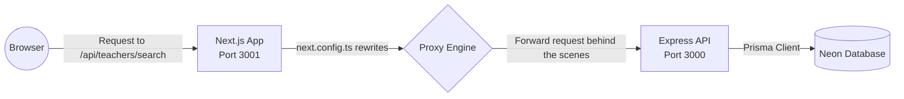

# 🏗️ Zads Project Overview — Project Layout & Design Decisions


> **Goal of this file:** Understand the project as a whole — why we chose these technologies, how we organized the files, and the philosophy behind every decision.
<blockquote dir="rtl">

*الهدف هنا إنك تاخد فكرة عامة وسريعة عن المشروع من فوق، عشان تبقى فاهم الدنيا ماشية إزاي من قبل ما تدخل في التفاصيل.*

</blockquote>

---

## 📌 What is Zads?

**Zads** is a local educational platform that connects learners (students, parents, professionals) with teachers and instructors **in the same geographical area**.

The core idea: **"Educational Neighborhood"** — making access to private tutoring easy and close by.
<blockquote dir="rtl">

*من الآخر كده، زاد هو فكرة محلية بتعتمد على "الجيرة التعليمية" عشان تقرب المدرسين والطلبة في نفس المنطقة.*

</blockquote>

### Supported Lesson Types:
| Type | Description |
|-------|-------------|
| **Online** | Online lessons via internet |
| **At Learner's Place** | Tutor goes to the student |
| **At Tutor's Place** | Student goes to the tutor |
| **At a Dedicated Venue** | Center or study room |

<blockquote dir="rtl">

*هنا بقى مدلعين الزبون، الحصص متاحة بكل الطرق الممكنة: أونلاين، دليفري لحد عندك، أو تروحله، أو حتى في سنتر.*

</blockquote>

### Main User Types (3 types):
1. **Client/Learner** (`parent`) — Searches for teachers, manages children, and sends contact requests.
2. **Teacher** (`teacher`) — Manages profile, subjects, pricing, and receives requests.
3. **Admin** (`admin`) — Manages the entire platform.

<blockquote dir="rtl">

*خد بالك إن الكود والـ Database قايمين على التلاتة دول بالظبط: parent و teacher و admin.*

</blockquote>

---

## 🧱 Project Structure (Monorepo)

```
Zads/
├── zads-app/          ← Frontend — Next.js 16 (The app that users see)
├── zads-api/          ← Backend — Express.js (The server interacting with the database)
├── legacy/            ← Old code — Vue 3/Nuxt 3 (Archived, not used)
├── .github/workflows/ ← CI/CD — GitHub Actions (Auto deployment)
├── learn/             ← 📚 Learning files (You are here!)
├── README.md          ← Project description
├── DOCUMENTATION.md   ← Unified documentation
└── DEPLOY.md          ← Deployment guide
```

### Why Monorepo?

> **Monorepo** = All code in a single Git repository, but each project is independent.

- ✅ Easy to see Frontend and Backend together.
- ✅ Single Pull Request if you need to change both.
- ✅ No workspaces — each project (`zads-app`, `zads-api`) has its own independent `pnpm-lock.yaml`.
- ✅ Independently deployed on Vercel.

<blockquote dir="rtl">

*المونوريبو ده مريح جداً، كل حاجة في مكان واحد بدل ما تفتح كذا ريبو وتدوخ نفسك.*

</blockquote>

---

## ⚙️ Tech Stack — Why we chose each technology?

### Frontend (`zads-app`)

| Technology | Purpose | Why we chose it? |
|------------|---------|------------------|
| **Next.js 16** | Main Framework | App Router + SSR + API Routes + Image Optimization |
| **React 19** | UI Library | Largest community, new Server Components |
| **TypeScript** | Programming Language | Type safety reduces bugs |
| **Tailwind CSS v4** | Styling | Utility-first, fast, and flexible |
| **shadcn/ui** | UI Components | Built on Radix, fully customizable |
| **Zustand** | State Management | Simple and lightweight, much easier than Redux |
| **next-intl** | Translation | Built-in Arabic/English support with App Router |
| **NextAuth.js v5** | Authentication | Credentials provider + JWT strategy |
| **CASL** | Permissions | Role-based permissions (admin/teacher/parent) |
| **react-hook-form + Zod** | Forms | Strong validation with TypeScript |
| **axios** | HTTP Client | Interceptors for the auth token |

<blockquote dir="rtl">

*الـ Stack بتاع الفرونت إند جامد جداً ومواكب أحدث الممارسات (React 19 و Tailwind v4). هتستمتع بيه بجد.*

</blockquote>

### Backend (`zads-api`)

| Technology | Purpose | Why we chose it? |
|------------|---------|------------------|
| **Express.js** | Main Framework | Most common, simple, and flexible |
| **Prisma ORM** | Database Interaction | Type-safe, automatic migrations, schema-first |
| **PostgreSQL** | Database | Robust, relational, with JSON support |
| **Neon** | Database Hosting | Serverless PostgreSQL, free tier for starters |
| **JWT** | Authentication | Stateless authentication |
| **Zod** | Data Validation | Runtime validation + TypeScript inference |
| **Helmet** | Security | Automatic security headers |
| **Multer** | File Uploads | File upload middleware |

<blockquote dir="rtl">

*الباك إند بسيط وخفيف، إكسبريس مع بريزما قايمين بالواجب وزيادة، ومفيش تعقيد ملوش لازمة.*

</blockquote>

---

## 🔄 How do they work together? (Architecture Flow)

```
┌─────────────────────────────────────────────────────────────┐
│                        User (Browser)                       │
└─────────────────────┬───────────────────────────────────────┘
                      │
                      ▼
┌─────────────────────────────────────────────────────────────┐
│                 Next.js App (zads-app)                       │
│                   Port 3001                                  │
│                                                              │
│  ┌──────────┐  ┌──────────┐  ┌──────────┐  ┌──────────┐    │
│  │  Pages   │  │Components│  │  Stores  │  │   Auth   │    │
│  │(App      │  │(shadcn + │  │(Zustand) │  │(NextAuth)│    │
│  │ Router)  │  │ shared)  │  │          │  │          │    │
│  └────┬─────┘  └──────────┘  └────┬─────┘  └────┬─────┘    │
│       │                           │              │           │
│       └───────────────────────────┼──────────────┘           │
│                                   │                          │
│                    next.config.ts rewrites                    │
│                    /api/* → Express API                      │
└─────────────────────┬───────────────────────────────────────┘
                      │ HTTP (axios)
                      ▼
┌─────────────────────────────────────────────────────────────┐
│                Express API (zads-api)                         │
│                   Port 3000                                  │
│                                                              │
│  ┌──────────┐  ┌──────────┐  ┌──────────┐  ┌──────────┐    │
│  │  Routes  │  │Controllers│ │Middleware │  │  Utils   │    │
│  │          │→ │(Logic)    │ │(Auth+Err) │  │(Response)│    │
│  └──────────┘  └────┬─────┘  └──────────┘  └──────────┘    │
│                      │                                       │
│                Prisma ORM                                    │
└─────────────────────┬───────────────────────────────────────┘
                      │ SQL
                      ▼
┌─────────────────────────────────────────────────────────────┐
│              PostgreSQL (Neon Serverless)                     │
│                                                              │
│  ┌──────────────────────────────────────────────────────┐    │
│  │  18 Tables: users, teachers, parents, subjects,      │    │
│  │  stages, favorites, contact_requests, tutor_requests, │    │
│  │  governorates, cities, areas, ...                     │    │
│  └──────────────────────────────────────────────────────┘    │
└─────────────────────────────────────────────────────────────┘
```

#### 🔄 Proxy Request Flow:



<blockquote dir="rtl">

*الـ Proxy ده حكاية، بيخلينا نكلم الباك إند كأنه على نفس البورت بتاع الفرونت إند عشان نتفادى مشاكل الـ CORS المشهورة.*

</blockquote>

### Request Flow:

1. **User** opens a page in the browser → Next.js renders the page.
2. **Page** uses a Zustand store to fetch data.
3. **Store** sends an HTTP request via axios → `/api/teachers/search`.
4. **Next.js** proxies (rewrites) the request → Express API on port 3000.
5. **Express** routes it through middleware (auth → validation) → Controller.
6. **Controller** uses Prisma to read/write in PostgreSQL.
7. **Response** goes back through the same path ← Controller ← Express ← Next.js ← Browser.

<blockquote dir="rtl">

*اللفة دي بتحصل في أجزاء من الثانية، والـ flow ده موحد في كل الـ features بتاعة السيستم.*

</blockquote>

---

## 📁 How we organized the files?

### Frontend (`zads-app/src/`)

```
src/
├── app/           ← Pages (File-based routing)
│   └── [locale]/  ← Every page is inside a locale segment (en/ar) for translation
│       ├── admin/     ← Admin pages
│       ├── auth/      ← Login/Register
│       ├── client/    ← Client/Learner dashboard
│       ├── public/    ← Public pages
│       └── teacher/   ← Teacher dashboard
│
├── components/    ← Shared components
│   ├── ui/        ← Core shadcn components (button, card, dialog...)
│   ├── shared/    ← Project-specific components (TeacherCard, ErrorBanner...)
│   ├── layout/    ← Layout structure (Navbar, Footer, Sidebar)
│   └── admin/     ← Admin-specific components (DataTable)
│
├── stores/        ← Zustand stores (each domain has its own store)
├── lib/           ← Core utilities (auth, api, utils, ability)
├── types/         ← TypeScript interfaces
├── i18n/          ← Translation setup + locale files
└── hooks/         ← Custom hooks (currently empty)
```

**Philosophy:**
- 📂 **Feature-based in Pages:** Each portal (admin/client/teacher) has its own independent folder.
- 📂 **Type-based in Components:** `ui/` for core primitives, `shared/` for reusable project pieces, and `layout/` for structural components.
- 📂 **Domain-based in Stores:** Each feature has its own store (auth, search, favorites...).

<blockquote dir="rtl">

*التقسيمة دي بتخليك توصل لأي فايل في ثواني، ومبتخليش الفولدرات زحمة وملعبكة في بعضها.*

</blockquote>

### Backend (`zads-api/src/`)

```
src/
├── app.js             ← Entry point — Express setup + middleware + routes
├── config/            ← Configuration (database, env, firebase)
├── routes/            ← Route definitions (13 files, 1:1 mapping with controllers)
├── controllers/       ← Business logic controllers
├── middlewares/        ← auth + error handler + validation middlewares
├── services/          ← Services (only notifications for now)
└── utils/             ← Utility helpers (response format, validators)
```

**Philosophy:**
- 📂 **MVC-like without Model layer:** Routes → Controllers → Prisma directly.
- 📂 **1:1 mapping:** Each route file has a matching controller file.
- 📂 **Thin middleware:** Authentication, error handling, and validation live in `middlewares/`.
- 📂 **Centralized config:** All configurations reside in `config/`.

<blockquote dir="rtl">

*هنا مفيش Models لأن بريزما هي اللي بتلعب دور الـ Model وهي اللي بتتعامل مع الجداول علطول من خلال الـ Controller.*

</blockquote>

---

## 🚀 Deployment

```
┌─────────────────────────────────────────────────┐
│                   GitHub                         │
│                                                  │
│  Push to main                                    │
│  ├── zads-app/** changed → deploy-app.yml        │
│  └── zads-api/** changed → deploy-api.yml        │
└────────┬──────────────────────┬──────────────────┘
         │                      │
         ▼                      ▼
┌────────────────┐    ┌────────────────┐
│   Vercel       │    │   Vercel       │
│   zads.app     │    │ api.zads.app   │
│   (Next.js)    │    │ (Express)      │
└────────────────┘    └────────────────┘
         │                      │
         └──────────┬───────────┘
                    │
                    ▼
         ┌──────────────────┐
         │  Neon PostgreSQL  │
         │  (Serverless)     │
         └──────────────────┘
```

- Every push to main automatically triggers a GitHub Action.
- Vercel deploys each project independently.
- Neon provides serverless PostgreSQL (spins down to zero when there is no traffic).

<blockquote dir="rtl">

*الـ CI/CD معمول على الفرازة، بمجرد ما تعمل push على المين، الأكشنز بتنطلق وتنشر الشغل فوراً.*

</blockquote>

---

## 🔑 Environment Variables

### Important Files:
- 📄 [`.env.example`](file:///Users/sayed/Devs/Zads/zads-api/.env.example) — API variables
- 📄 [`.env.local.example`](file:///Users/sayed/Devs/Zads/zads-app/.env.local.example) — Frontend variables

### Most Important Variables:

| Variable | Location | Purpose |
|----------|----------|---------|
| `DATABASE_URL` | API | PostgreSQL connection URL (pooled — for application traffic) |
| `DIRECT_URL` | API | PostgreSQL connection URL (direct — for migrations) |
| `JWT_SECRET` | API | JWT signing key |
| `NEXT_PUBLIC_API_BASE_URL` | App | Public API base URL |
| `NEXTAUTH_SECRET` | App | NextAuth secret key |

<blockquote dir="rtl">

*اوعى ترفع ملف الـ .env الحقيقي على جيت هاب! دايمًا استخدم الـ .example عشان توضح لغيرك إيه المتغيرات المطلوبة.*

</blockquote>

---

## 📚 Important Files Roadmap — Start Here

### Start with a general understanding:
1. 📄 [README.md](file:///Users/sayed/Devs/Zads/README.md) — Project description
2. 📄 [DOCUMENTATION.md](file:///Users/sayed/Devs/Zads/DOCUMENTATION.md) — Full documentation
3. 📄 [DEPLOY.md](file:///Users/sayed/Devs/Zads/DEPLOY.md) — How to deploy

### Frontend (Important files first):
1. 📄 [next.config.ts](file:///Users/sayed/Devs/Zads/zads-app/next.config.ts) — Next.js config + proxy setup
2. 📄 [layout.tsx](file:///Users/sayed/Devs/Zads/zads-app/src/app/[locale]/layout.tsx) — Root layout
3. 📄 [auth.ts](file:///Users/sayed/Devs/Zads/zads-app/src/lib/auth.ts) — Authentication setup
4. 📄 [api.ts](file:///Users/sayed/Devs/Zads/zads-app/src/lib/api.ts) — Axios instance
5. 📄 [globals.css](file:///Users/sayed/Devs/Zads/zads-app/src/app/globals.css) — Global CSS styles

### Backend (Important files first):
1. 📄 [app.js](file:///Users/sayed/Devs/Zads/zads-api/src/app.js) — Entry point
2. 📄 [schema.prisma](file:///Users/sayed/Devs/Zads/zads-api/prisma/schema.prisma) — Database schema
3. 📄 [auth.js](file:///Users/sayed/Devs/Zads/zads-api/src/middlewares/auth.js) — Authentication middleware
4. 📄 [auth.controller.js](file:///Users/sayed/Devs/Zads/zads-api/src/controllers/auth.controller.js) — Authentication logic
5. 📄 [response.js](file:///Users/sayed/Devs/Zads/zads-api/src/utils/response.js) — Response formatting

---

## ⏭️ Next Step

Start with the following learning files in order:

1. 📗 [01-nextjs-react.md](file:///Users/sayed/Devs/Zads/learn/en/01-nextjs-react.md) — Learn Next.js & React from the project
2. 📙 [02-expressjs-node.md](file:///Users/sayed/Devs/Zads/learn/en/02-expressjs-node.md) — Learn Express.js & Node.js from the project
3. 📘 [03-postgresql-prisma.md](file:///Users/sayed/Devs/Zads/learn/en/03-postgresql-prisma.md) — Learn PostgreSQL & Prisma from the project
