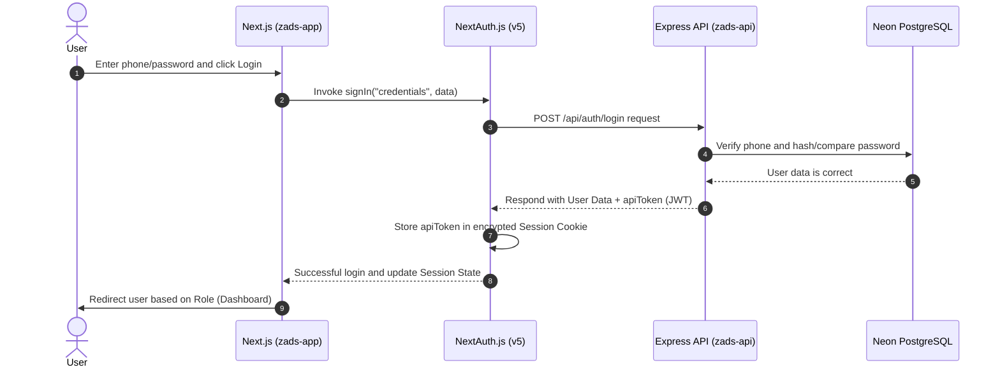

# 📗 Next.js & React Learning Roadmap — from the Zads Project


> **Level:** From scratch to a complete understanding of the project's code
> **Expected Time:** 4-6 weeks (2 hours/day)
> **Method:** Each topic contains an explanation + link to a real file in the project to review

<blockquote dir="rtl">

*الخطة دي معمولة عشان تدخلك في كود نيكست ورياكت بكل سلاسة، وكمان رابطين كل مفهوم بملف حقيقي في كود زاد عشان تشوف التطبيق العملي بعينك.*

</blockquote>

---

## 🗺️ The Complete Roadmap

```
Phase 1: React Basics ← (Week 1)
    │
    ▼
Phase 2: Next.js App Router ← (Week 2)
    │
    ▼
Phase 3: Styling & Components ← (Week 3)
    │
    ▼
Phase 4: State & Data Management ← (Week 3-4)
    │
    ▼
Phase 5: Authentication & Permissions ← (Week 4)
    │
    ▼
Phase 6: Translation & Internationalization (i18n) ← (Week 5)
    │
    ▼
Phase 7: Advanced Patterns ← (Week 5-6)
```

<blockquote dir="rtl">

*الخريطة دي متقسمة مراحل منطقية عشان متهش، خد وقتك في كل مرحلة وماتستعجلش.*

</blockquote>

---

## 📦 Phase 1: React Basics (Before you start Next.js)

> **Goal:** Understand basic React — Components, props, state, and hooks.
<blockquote dir="rtl">

*رياكت هي الطوبة الأساسية اللي مبني عليها المشروع كله، لو فهمتها صح كل اللي جاي هيبقى سهل جداً.*

</blockquote>

### 1.1 What is React?

React is a JavaScript library for building user interfaces. The core ideas are:
- **Components:** Every part of the page is an independent, reusable component.
- **JSX:** Writing HTML-like syntax inside JavaScript.
- **State:** The data that changes and triggers the page to update automatically.

<blockquote dir="rtl">

*بدل ما نكتب كود جافا سكريبت طويل وممل عشان نغير كلمة في الصفحة، رياكت بتعمل ده بذكاء عن طريق الـ State.*

</blockquote>

### 1.2 React Components — Examples from the Project

#### Simple Component (Functional Component):

```tsx
// مكون React بسيط — بياخد props وبيعرض UI
function TeacherCard({ teacher }) {
    return (
        <div>
            <h2>{teacher.name}</h2>
            <p>{teacher.bio}</p>
        </div>
    );
}
```

📄 **Check these components in the project:**
- [TeacherCard](file:///Users/sayed/Devs/Zads/zads-app/src/components/shared/TeacherCard.tsx) — Tutor card (shared component repeated in multiple pages).
- [ErrorBanner](file:///Users/sayed/Devs/Zads/zads-app/src/components/shared/ErrorBanner.tsx) — Error display banner.
- [PageSkeleton](file:///Users/sayed/Devs/Zads/zads-app/src/components/shared/PageSkeleton.tsx) — Loading structure skeleton.

**Notice in these files:**
- `"use client"` at the very top → This means this component runs in the browser (Client Component).
- `import { useTranslations } from "next-intl"` → Uses the translation hook.
- `const t = useTranslations("namespace")` → Gets the translation function.
- `t("key")` → Translates the text.

<blockquote dir="rtl">

*خد بالك إن `"use client"` مهمة جداً لو المكون بتاعك هيحتاج تفاعل مع المستخدم زي الكليكات أو الـ Hooks.*

</blockquote>

### 1.3 Core React Hooks

| Hook | Purpose | Example from the project |
|------|---------|--------------------------|
| `useState` | Store mutable data | Any form state |
| `useEffect` | Run code on page mount | Fetching data from the API |
| `useCallback` | Cache a function definition | Event handlers |
| `useMemo` | Cache the result of a calculation | Filtering data |

📄 **See how hooks are used:**
- Open any page in [client/](file:///Users/sayed/Devs/Zads/zads-app/src/app/[locale]/client) — you will find `useEffect` used for fetching data.
- Open any page in [teacher/](file:///Users/sayed/Devs/Zads/zads-app/src/app/[locale]/teacher) — you will find `useState` used for form handling.

<blockquote dir="rtl">

*الـ Hooks دي هي اللي بتدي القوة لـ React، وبنستخدمها عشان نخلي الصفحات حية وتتفاعل مع اليوزر.*

</blockquote>

### 1.4 Props and Children

```tsx
// Props = البيانات اللى بتتبعت للمكون
<Button variant="outline" size="sm" onClick={handleClick}>
    اضغط هنا
</Button>
 
// Children = اللى جوا الـ tag
<Card>
    <CardHeader>العنوان</CardHeader>  {/* ← children */}
    <CardContent>المحتوى</CardContent>
</Card>
```

📄 **Check shadcn/ui components:**
- [Button](file:///Users/sayed/Devs/Zads/zads-app/src/components/ui/button.tsx) — Notice how it accepts `variant` and `size` as props.
- [Card](file:///Users/sayed/Devs/Zads/zads-app/src/components/ui/card.tsx) — Notice sub-components like `CardHeader`, `CardContent`, and `CardFooter`.

<blockquote dir="rtl">

*الـ Props دي هي الطريقة اللي بنمرر بيها البيانات من المكون الأب للمكون الابن، والـ children هي أي حاجة بنكتبها جو التاجز.*

</blockquote>

---

## 📦 Phase 2: Next.js App Router

> **Goal:** Understand how Next.js organizes pages and routes.
<blockquote dir="rtl">

*نيكست جي إس بيشيل عنك هم عمل الراوتنج يدوي، بمجرد ما تعمل فولدر جديد بقى عندك صفحة فوراً.*

</blockquote>

### 2.1 What is the difference between React and Next.js?

| React (Without Next.js) | Next.js |
|-------------------------|---------|
| Single Page App (SPA) | Multi-page App (SSR + SSG) |
| Manual routing required | Automatic File-based routing |
| All code runs in browser | Server Components + Client Components |
| SEO is difficult | SEO is handled automatically |
| Manual API proxy needed | Built-in Rewrites + API Routes |

<blockquote dir="rtl">

*نيكست هو الأخ الكبير لرياكت، بياخد رياكت ويديها مميزات خارقة زي الـ SSR والسيرفر كومبوننتس.*

</blockquote>

### 2.2 File-Based Routing — Core Concept

In Next.js, **file path = URL path**:

```
src/app/[locale]/auth/login/page.tsx    →  /en/auth/login
src/app/[locale]/client/page.tsx        →  /en/client
src/app/[locale]/teacher/profile/page.tsx  →  /en/teacher/profile
src/app/[locale]/admin/teachers/page.tsx   →  /en/admin/teachers
```

**Rules:**
- `page.tsx` → The actual page component (must be named `page`).
- `layout.tsx` → The frame wrapping the page (navbar, sidebar).
- `[locale]` → Dynamic segment (variable — can be `en` or `ar`).
- `loading.tsx` → Loading page (optional).
- `error.tsx` → Error page (optional).

📄 **Check the page structure:**
- [app/page.tsx](file:///Users/sayed/Devs/Zads/zads-app/src/app/page.tsx) — Root page (`/`) — redirects to `/en/public`.
- [app/[locale]/layout.tsx](file:///Users/sayed/Devs/Zads/zads-app/src/app/[locale]/layout.tsx) — The base layout for all pages.

<blockquote dir="rtl">

*لو عملت فولدر جديد باسم test وجواه page.tsx، كدة مبروك عليك بقى عندك صفحة /test من غير أي تعب.*

</blockquote>

### 2.3 Layouts — Nested Layouts

Next.js supports **Nested Layouts** — meaning a layout inside another layout:

```
RootLayout (src/app/layout.tsx)
  └── LocaleLayout (src/app/[locale]/layout.tsx)        ← HTML + Providers
       ├── PublicLayout (public/layout.tsx)              ← Navbar + Footer
       ├── AuthLayout (auth/layout.tsx)                  ← Centered card
       ├── ClientLayout (client/layout.tsx)              ← Sidebar
       ├── TeacherLayout (teacher/layout.tsx)            ← Sidebar
       └── AdminLayout (admin/layout.tsx)                ← Sidebar
```

📄 **Check layouts in the project:**
- [Root Layout](file:///Users/sayed/Devs/Zads/zads-app/src/app/layout.tsx) — Simplest layout (loads `globals.css` and renders `children`).
- [Locale Layout](file:///Users/sayed/Devs/Zads/zads-app/src/app/[locale]/layout.tsx) — **Most Important** — adds:
  - `<html lang={locale} dir={rtl|ltr}>` — Page direction.
  - `SessionProvider` — Makes authentication session available everywhere.
  - `NextIntlClientProvider` — Makes translation keys available everywhere.
  - `Toaster` — Notifications toast.
- [Client Layout](file:///Users/sayed/Devs/Zads/zads-app/src/app/[locale]/client/layout.tsx) — Adds the client-specific Sidebar.
- [Admin Layout](file:///Users/sayed/Devs/Zads/zads-app/src/app/[locale]/admin/layout.tsx) — Adds the admin-specific Sidebar.

**Notice the pattern:**
```tsx
// layout.tsx نموذجي
export default function ClientLayout({ children }) {
    return (
        <div className="flex">
            <DashboardSidebar role="client" />
            <main className="flex-1">{children}</main>
        </div>
    );
}
```

<blockquote dir="rtl">

*الـ Nested Layouts دي بتخلينا نعمل هيكل موحد لكل لوحة تحكم (مثلاً سايدبار للمدرسين وسايدبار مختلف للطلبة) بكل سهولة.*

</blockquote>

### 2.4 Server Components vs Client Components

> **One of the most important concepts in modern Next.js!**

| Server Component | Client Component |
|------------------|------------------|
| **Default** — Every component is Server unless marked otherwise | Must write `"use client"` at the top |
| Runs on server only | Runs in the browser |
| No JavaScript sent to browser (smaller bundle size) | Complete code sent to browser |
| Cannot use hooks like `useState`, `useEffect` | Can use all hooks |
| Can use `async` to fetch data directly | Must fetch via `useEffect` or state stores |

📄 **Check the difference in the project:**
- [public/page.tsx](file:///Users/sayed/Devs/Zads/zads-app/src/app/[locale]/public/page.tsx) — **Server Component** (No `"use client"`) — public page.
- [client/page.tsx](file:///Users/sayed/Devs/Zads/zads-app/src/app/[locale]/client/page.tsx) — **Client Component** (`"use client"`) — client dashboard (uses `useEffect`, `useState`).

<blockquote dir="rtl">

*الـ Server Components بتخلي الموقع سريع وخفيف جداً لأن الكود بيرندر على السيرفر وبيبعت HTML للمتصفح، والـ Client Components بنستخدمها لما نحتاج تفاعلية.*

</blockquote>

### 2.5 Dynamic Routes

```
[locale]  → Dynamic segment — changes based on language (ar/en)
```

In the project, we use `[locale]` as a dynamic parameter to set the language. Next.js reads the value from the URL and passes it as a parameter.

📄 **Check usage:**
- [routing.ts](file:///Users/sayed/Devs/Zads/zads-app/src/i18n/routing.ts) — Definition of supported languages.

<blockquote dir="rtl">

*الفولدر اللي بين قوسين مربعين [param] ده معناه إن القيمة دي متغيرة وممكن نقراها جوة الكود عشان نعرف مثلاً اليوزر فاتح عربي ولا إنجليزي.*

</blockquote>

### 2.6 API Routes in Next.js

Next.js allows creating API endpoints inside the app:

```
src/app/api/auth/[...nextauth]/route.ts   →  /api/auth/*     (NextAuth only)
src/app/api/[...backend]/route.ts         →  /api/*         (Express BFF proxy)
```

📄 **Check in project:**
- `zads-app/src/app/api/auth/[...nextauth]/route.ts` — NextAuth credentials and session.
- `zads-app/src/app/api/[...backend]/route.ts` — Forwards every other `/api/*` call to Express. It drops the session cookie and strips upstream Helmet/compression headers.

> **Note:** The API proxy is this route handler. `next.config.ts` no longer rewrites `/api/*`.

<blockquote dir="rtl">

*الـ API Routes في نيكست ممتازة للحاجات السريعة أو الـ Auth، وباقي الشغل التقيل محولينه للباك إند علطول.*

</blockquote>

### 2.7 Next.js Config

📄 **Check settings:**
- `zads-app/next.config.ts` — Notice:
  - `redirects()` — Legacy paths (`/parent` → `/client`, old marketing URLs → `/public`).
  - `images.remotePatterns` — Allows loading images from the API host.
  - `createNextIntlPlugin` — Enables translation support.
  - API proxy lives in `src/app/api/[...backend]/route.ts`, not here.

<blockquote dir="rtl">

*الـ proxy اتنقل لـ route handler عشان نقدر ننضّف هيدرز الـ API قبل ما توصل للمتصفح. ملف الإعدادات فاضل للصور والتحويلات القديمة.*

</blockquote>

---

## 📦 Phase 3: Styling & Components

> **Goal:** Understand Tailwind CSS + shadcn/ui and how we build user interfaces.
<blockquote dir="rtl">

*هنا بقى بنصنع الجمال! ميكس سريع بين تايلوند وشاد سي إن بيطلع واجهات فخمة وبأقل كود ممكن.*

</blockquote>

### 3.1 Tailwind CSS — Basics

Tailwind is a **Utility-first CSS framework** — instead of writing custom CSS, you use pre-defined utility classes directly:

```html
<!-- CSS تقليدي -->
<div style="display: flex; gap: 16px; padding: 8px; background: blue;">
 
<!-- Tailwind -->
<div className="flex gap-4 p-2 bg-blue-500">
```

**Core Utilities:**
| Category | Examples | Meaning |
|----------|---------|---------|
| Layout | `flex`, `grid`, `block` | Display type |
| Spacing | `p-4`, `m-2`, `gap-3` | padding, margin, gap |
| Sizing | `w-full`, `h-screen`, `max-w-md` | width & height |
| Colors | `bg-primary`, `text-white` | background & text color |
| Typography | `text-lg`, `font-bold` | font size & weight |
| Responsive | `md:flex`, `lg:grid-cols-3` | applied at responsive breakpoints |
| Dark Mode | `dark:bg-gray-900` | dark mode styling |

📄 **Check global styles:**
- [globals.css](file:///Users/sayed/Devs/Zads/zads-app/src/app/globals.css) — Notice:
  - `@theme inline` — Definition of main theme colors (Primary: `#06358d`, Secondary: `#f68023`).
  - CSS variables for shadcn (light + dark modes).
  - `--radius: 1.25rem` — Large rounded corners.

<blockquote dir="rtl">

*تايلوند بتخلي التنسيق سريع جداً، وبتتحكم في كل تفصيلة في الـ UI من غير ما تسيب ملف الـ HTML.*

</blockquote>

### 3.2 shadcn/ui — Ready-to-use Components

shadcn/ui is not a traditional library — it is a **collection of copy-paste components** that you add directly to your project and customize.

📄 **Check used components:**
- [button.tsx](file:///Users/sayed/Devs/Zads/zads-app/src/components/ui/button.tsx) — Button.
- [card.tsx](file:///Users/sayed/Devs/Zads/zads-app/src/components/ui/card.tsx) — Card.
- [dialog.tsx](file:///Users/sayed/Devs/Zads/zads-app/src/components/ui/dialog.tsx) — Modal dialog.
- [input.tsx](file:///Users/sayed/Devs/Zads/zads-app/src/components/ui/input.tsx) — Input field.
- [select.tsx](file:///Users/sayed/Devs/Zads/zads-app/src/components/ui/select.tsx) — Dropdown select.
- [table.tsx](file:///Users/sayed/Devs/Zads/zads-app/src/components/ui/table.tsx) — Data table.
- [tabs.tsx](file:///Users/sayed/Devs/Zads/zads-app/src/components/ui/tabs.tsx) — Tab selector.
- [sheet.tsx](file:///Users/sayed/Devs/Zads/zads-app/src/components/ui/sheet.tsx) — Sliding sidebar panel.

**Notice the pattern in each component:**
```tsx
// 1. بيستخدم cva (class-variance-authority) لتعريف variants
const buttonVariants = cva("base-classes", {
    variants: {
        variant: { default: "...", outline: "..." },
        size: { default: "...", sm: "...", lg: "..." },
    },
});
 
// 2. بياخد props + ref (forwardRef)
const Button = React.forwardRef(({ variant, size, ...props }, ref) => (
    <button className={cn(buttonVariants({ variant, size }))} ref={ref} {...props} />
));
```

📄 **Check settings:**
- [components.json](file:///Users/sayed/Devs/Zads/zads-app/components.json) — Configuration (style: base-nova, RSC: true).

<blockquote dir="rtl">

*شاد سي إن مش بيكتفك بكود مقفول، ده بيديك الكومبوننت حاف جوة مشروعك عشان تعدل فيه براحتك.*

</blockquote>

### 3.3 The `cn()` Utility — Merging Classes

```ts
// src/lib/utils.ts
import { clsx } from "clsx";
import { twMerge } from "tailwind-merge";
 
export function cn(...inputs) {
    return twMerge(clsx(inputs));
}
```

**Why is it important?** It lets you merge classes dynamically:
```tsx
cn("p-4 bg-blue-500", isActive && "bg-green-500")
// لو isActive = true → "p-4 bg-green-500" (twMerge بيشيل التكرار)
```

📄 **Check:**
- [utils.ts](file:///Users/sayed/Devs/Zads/zads-app/src/lib/utils.ts) — Contains `cn()` + `formatPrice()` + `getInitials()` + `extractError()`.

<blockquote dir="rtl">

*الـ `cn` دي منقذة للبشرية! بتدمج الكلاسات من غير ما يحصل خناق أو تكرار في كلاسات تايلوند.*

</blockquote>

### 3.4 Layout Components — Navbar and Sidebar

📄 **Check structural components:**
- [Navbar](file:///Users/sayed/Devs/Zads/zads-app/src/components/layout/Navbar.tsx) — Top navigation bar.
- [Footer](file:///Users/sayed/Devs/Zads/zads-app/src/components/layout/Footer.tsx) — Footer bar.
- [DashboardSidebar](file:///Users/sayed/Devs/Zads/zads-app/src/components/layout/DashboardSidebar.tsx) — Shared sidebar component (takes `role` prop and displays different menus).

**Notice in DashboardSidebar:**
- Takes `role` prop (`"client"` | `"teacher"` | `"admin"`).
- Displays different menus based on the role.
- Uses `usePathname()` to determine the current page (active state).
- Uses `useTranslations()` to render localized text.

<blockquote dir="rtl">

*الـ Sidebar ده شغال بذكاء شديد، هو فايل واحد بس بنبعتله الـ role وهو بيفهم هيعرض إيه لوحده.*

</blockquote>

---

## 📦 Phase 4: State & Data Management

> **Goal:** Understand Zustand and how we store and fetch data.
<blockquote dir="rtl">

*انسى تعقيد ريدكس والـ Boilerplate الـ كتير بتاعه، زوستند بسيط جداً وحرفياً كأنه useState بس على مستوى التطبيق كله.*

</blockquote>

### 4.1 What is Zustand?

Zustand is a very simple **state management library** — a lightweight alternative to Redux:

```ts
// Redux → كتير من الكود (actions, reducers, selectors, dispatch)
// Zustand → 10 سطور وخلاص ✅
```

### 4.2 Pattern used in the project (Convention)

Every store in the project follows the same pattern:

📄 **Check convention first:**
- [_convention.ts](file:///Users/sayed/Devs/Zads/zads-app/src/stores/_convention.ts) — **Read this first** — contains:
  - `StoreSlice<T>` — Shared interface for slices.
  - `initialSlice<T>()` — Default values.
  - `extractError()` — Error extractor utility.

**Basic pattern:**
```ts
interface MyStore {
    data: Item[];
    isLoading: boolean;
    error: string | null;
    fetch: () => Promise<void>;
    reset: () => void;
}
 
const useMyStore = create<MyStore>((set) => ({
    data: [],
    isLoading: false,
    error: null,
 
    fetch: async () => {
        set({ isLoading: true, error: null });
        try {
            const res = await apiGet<Item[]>("/api/items");
            set({ data: res.data, isLoading: false });
        } catch (err) {
            set({ error: extractError(err), isLoading: false });
        }
    },
 
    reset: () => set({ data: [], isLoading: false, error: null }),
}));
```

<blockquote dir="rtl">

*الـ Convention ده مريح جداً عشان مخلي كل الـ stores ليها نفس الهيكل وطريقة معالجة الأخطاء.*

</blockquote>

### 4.3 Stores in the Project

📄 **Check each store in order:**

#### Basics:
- [auth.ts](file:///Users/sayed/Devs/Zads/zads-app/src/stores/auth.ts) — **Start here** — Login, registration, profile update.
- [search.ts](file:///Users/sayed/Devs/Zads/zads-app/src/stores/search.ts) — Tutor search (includes pagination + filters).

#### Client:
- [client.ts](file:///Users/sayed/Devs/Zads/zads-app/src/stores/client.ts) — Client profile.
- [dependents.ts](file:///Users/sayed/Devs/Zads/zads-app/src/stores/dependents.ts) — Dependent/Children CRUD.
- [favorites.ts](file:///Users/sayed/Devs/Zads/zads-app/src/stores/favorites.ts) — Favorites list.

#### Teacher:
- [teacher.ts](file:///Users/sayed/Devs/Zads/zads-app/src/stores/teacher.ts) — Teacher profile.
- [teacher-subjects.ts](file:///Users/sayed/Devs/Zads/zads-app/src/stores/teacher-subjects.ts) — Teacher subjects and prices.
- [teacher-availability.ts](file:///Users/sayed/Devs/Zads/zads-app/src/stores/teacher-availability.ts) — Teacher weekly availability.

#### Shared:
- [contact-requests.ts](file:///Users/sayed/Devs/Zads/zads-app/src/stores/contact-requests.ts) — Contact requests between parents and teachers.
- [tutor-requests.ts](file:///Users/sayed/Devs/Zads/zads-app/src/stores/tutor-requests.ts) — Public tutoring requests.

#### Admin:
- [admin.ts](file:///Users/sayed/Devs/Zads/zads-app/src/stores/admin.ts) — **Largest store** — Handles all admin panel actions.

<blockquote dir="rtl">

*كل دومين في السيستم ليه الـ store الخاصة بيه، فمفيش تداخل بيانات ولا لخبطة.*

</blockquote>

### 4.4 How does a page use a Store?

**Recurring pattern in every page:**

```tsx
"use client";
 
export default function FavoritesPage() {
    const { favorites, isLoading, error, fetchFavorites } = useFavoritesStore();
    const t = useTranslations("favorites");
 
    // 1. جلب البيانات عند تحميل الصفحة
    useEffect(() => {
        fetchFavorites();
    }, []);
 
    // 2. حالة التحميل
    if (isLoading) return <PageSkeleton />;
 
    // 3. حالة الخطأ
    if (error) return <ErrorBanner message={error} />;
 
    // 4. عرض البيانات
    return (
        <div>
            <h1>{t("title")}</h1>
            {favorites.map(fav => <TeacherCard key={fav.id} teacher={fav} />)}
        </div>
    );
}
```

📄 **Check real examples:**
- [client/favorites/page.tsx](file:///Users/sayed/Devs/Zads/zads-app/src/app/[locale]/client/favorites/page.tsx) — Favorites page.
- [client/dependents/page.tsx](file:///Users/sayed/Devs/Zads/zads-app/src/app/[locale]/client/dependents/page.tsx) — Dependents/Children page.
- [teacher/subjects/page.tsx](file:///Users/sayed/Devs/Zads/zads-app/src/app/[locale]/teacher/subjects/page.tsx) — Teacher subjects page.

<blockquote dir="rtl">

*النمط ده بيتكرر معاك كتير: بتشغل الـ fetch في الـ useEffect، تعرض صفحة التحميل، أو صفحة الخطأ لو حصل مشكلة، وأخيراً ترندر البيانات.*

</blockquote>

### 4.5 API Client — Axios

📄 **Check:**
- [api.ts](file:///Users/sayed/Devs/Zads/zads-app/src/lib/api.ts) — Axios instance.

**Important details:**
```ts
// 1. Base URL نسبي — Next.js بيعمل proxy
const api = axios.create({ baseURL: "/api" });
 
// 2. Request interceptor — بيضيف الـ token تلقائياً
api.interceptors.request.use(async (config) => {
    const session = await getSession();
    if (session?.apiToken) {
        config.headers.Authorization = `Bearer ${session.apiToken}`;
    }
    return config;
});
 
// 3. Response interceptor — لو 401 بيعمل sign out
api.interceptors.response.use(
    (response) => response,
    (error) => {
        if (error.response?.status === 401) signOut();
        return Promise.reject(error);
    }
);
 
// 4. Typed helpers
export const apiGet = <T>(url) => api.get<ApiResponse<T>>(url);
export const apiPost = <T>(url, data) => api.post<ApiResponse<T>>(url, data);
```

<blockquote dir="rtl">

*الـ interceptors بتسهل حياتنا، بتلزق الـ token تلقائياً في أي طلب رايح للـ API وبتعمل logout لو الـ token انتهى.*

</blockquote>

---

## 📦 Phase 5: Authentication & Permissions

> **Goal:** Understand how users log in and what happens behind the scenes.
<blockquote dir="rtl">

*نظام الأمان هنا متين وقائم على NextAuth v5 مع JWT مشفر بيتنقل بين السيرفر والفرونت إند.*

</blockquote>

### 5.1 Auth Flow

```
┌─────────────┐     ┌──────────────┐     ┌──────────────┐
│  Login Form │ ──→ │  NextAuth    │ ──→ │  Express API │
│  (React)    │     │  (signIn())  │     │  /api/auth/  │
│             │     │              │     │   login      │
└─────────────┘     └──────┬───────┘     └──────┬───────┘
                           │                     │
                    JWT token ←──── apiToken ─────┘
                           │
                    Session (cookie) ←── stored in browser
                           │
                    Bearer token sent with each API request automatically
```

#### 🔄 Sequence Diagram (NextAuth v5 + Express API JWT Handshake):



📄 **Check files in order:**

**1. Login Page:**
- [auth/login/page.tsx](file:///Users/sayed/Devs/Zads/zads-app/src/app/[locale]/auth/login/page.tsx) — Form UI + `signIn("credentials", ...)`.

**2. NextAuth Configuration:**
- [auth.ts](file:///Users/sayed/Devs/Zads/zads-app/src/lib/auth.ts) — **Very important file** — contains:
  - `CredentialsProvider` — Sends phone/password to the Express API.
  - `jwt callback` — Stores `apiToken`, `userType`, and `phone` inside the JWT token.
  - `session callback` — Makes the stored data available in `useSession()`.

**3. NextAuth API Route:**
- [route.ts](file:///Users/sayed/Devs/Zads/zads-app/src/app/api/auth/[...nextauth]/route.ts) — Catch-all route.

**4. Using the session inside pages:**
```tsx
const { data: session } = useSession();
// session.user.userType → "teacher" | "parent" | "admin"
// session.apiToken → JWT token من Express
```

<blockquote dir="rtl">

*الـ callbacks دي هي اللي بتخلي البيانات تفضل عايشة في الـ cookie ومتاحة للفرونت إند علطول.*

</blockquote>

### 5.2 Permissions (CASL)

📄 **Check:**
- [ability.tsx](file:///Users/sayed/Devs/Zads/zads-app/src/lib/ability.tsx) — Permissions definitions.

**Core concept:** Based on the `userType`, we define what actions the user is authorized to perform:

| Role | Permissions |
|------|-------------|
| `admin` | Everything (`manage all`) |
| `parent` | Manage children, requests, favorites, and view tutors |
| `teacher` | Manage subjects, contact requests, and view public requests |

<blockquote dir="rtl">

*الـ CASL بتخلينا نعمل شروط نضيفة وسهلة القراءة في الواجهة زي: Can I edit this button? من غير تعقيدات.*

</blockquote>

### 5.3 Route Protection — `src/proxy.ts`

Next.js 16 runs `src/proxy.ts` before the page renders. The file exports `proxy` and `config`. There is no separate `middleware.ts`.

📄 **Check:** `zads-app/src/proxy.ts`

```ts
const PROTECTED = [
    { pattern: /^\/[^/]+\/client(\/.*)?$/, role: "parent" },
    { pattern: /^\/[^/]+\/teacher(\/.*)?$/, role: "teacher" },
    { pattern: /^\/[^/]+\/admin(?!\/login)(\/.*)?$/, role: "admin" },
];
// Not signed in → /{locale}/auth/login
// Wrong role → that role's home (/client, /teacher, or /admin)
```

It also skips `/api` and static files, collapses doubled paths like `/client/client`, redirects old `/parent` URLs, and then hands the request to next-intl.

<blockquote dir="rtl">

*في Next.js 16 الملف اسمه `proxy.ts` وهو البوابة. مش محتاج `middleware.ts` زيادة.*

</blockquote>

---

## 📦 Phase 6: Translation & Internationalization (i18n)

> **Goal:** Understand how we translate the application between Arabic and English.
<blockquote dir="rtl">

*موقع زاد ثنائي اللغة، نيكست بيمسك الـ URL ويعرف منه اللغة اللي اليوزر عاوزها ويعرض المحتوى بناء عليها.*

</blockquote>

### 6.1 Structure

```
src/i18n/
├── routing.ts      ← Language definition: ['en', 'ar'], default: 'ar'
├── request.ts      ← Loads translation files on the server
└── locales/
    ├── ar.json     ← Arabic translation keys (~16KB)
    └── en.json     ← English translation keys (~12KB)
```

📄 **Check files:**
- [routing.ts](file:///Users/sayed/Devs/Zads/zads-app/src/i18n/routing.ts) — Language settings.
- [request.ts](file:///Users/sayed/Devs/Zads/zads-app/src/i18n/request.ts) — Translations loader.
- [ar.json](file:///Users/sayed/Devs/Zads/zads-app/src/i18n/locales/ar.json) — Arabic translation file.
- [en.json](file:///Users/sayed/Devs/Zads/zads-app/src/i18n/locales/en.json) — English translation file.

### 6.2 How do we use translations?

```tsx
// في أي مكون
const t = useTranslations("client.dashboard");
 
// في الـ template
<h1>{t("title")}</h1>        // → "لوحة التحكم" أو "Dashboard"
<p>{t("welcome")}</p>        // → "مرحباً" أو "Welcome"
```

### 6.3 RTL Support

```tsx
// في LocaleLayout
<html lang={locale} dir={locale === "ar" ? "rtl" : "ltr"}>
```

**Tailwind supports RTL automatically** via logical properties:
```html
<div className="ms-4">  <!-- margin-start: في LTR = margin-left, في RTL = margin-right -->
<div className="me-4">  <!-- margin-end: العكس -->
<div className="text-start">  <!-- text-align حسب الاتجاه -->
```

<blockquote dir="rtl">

*انسى الهبد بتاع ml و mr في التنسيق، دايمًا استخدم البادئات المنطقية زي ms و me عشان العربي والإنجليزي يظبطوا تلقائياً.*

</blockquote>

---

## 📦 Phase 7: Advanced Patterns

> **Goal:** Understand professional patterns utilized in the project.
<blockquote dir="rtl">

*دي الأنماط اللي بتفصل بين شغل الهواة والمحترفين، هتخلي كودك منظم وسهل التوسيع.*

</blockquote>

### 7.1 TypeScript Types

📄 **Check:**
- [types/index.ts](file:///Users/sayed/Devs/Zads/zads-app/src/types/index.ts) — **All types** (278 lines, 25+ types).

**Notice:** The frontend types mirror the Prisma models on the backend:
```ts
interface Teacher {
    id: string;
    userId: string;
    bio: string | null;
    experienceYears: number | null;
    // ... mirrors Prisma schema
}
```

<blockquote dir="rtl">

*الـ Types دي بتضمنلك إن البيانات اللي رايحة وجاية من الفرونت والباك متطابقة بنسبة 100% ومفيش مفاجآت.*

</blockquote>

### 7.2 Data Table Pattern

📄 **Check:**
- [DataTable](file:///Users/sayed/Devs/Zads/zads-app/src/components/admin/DataTable.tsx) — Advanced datatable component.

**Powered by `@tanstack/react-table`:**
- Sorting
- Filtering
- Pagination
- Responsive: Table on desktop + cards on mobile.

📄 **Check its usage:**
- [admin/teachers/page.tsx](file:///Users/sayed/Devs/Zads/zads-app/src/app/[locale]/admin/teachers/page.tsx) — Teacher table.
- [admin/parents/page.tsx](file:///Users/sayed/Devs/Zads/zads-app/src/app/[locale]/admin/parents/page.tsx) — Parent table.

<blockquote dir="rtl">

*الجدول ده ساحر، بيتعامل مع كميات بيانات مهولة وبيعرضها بشكل شيك جداً مع فلترة وترتيب تلقائي.*

</blockquote>

### 7.3 Form Pattern

**Tools:**
- `react-hook-form` — Form state management.
- `zod` — Validation schema definition.
- `@hookform/resolvers/zod` — Glue integration.

```tsx
const schema = z.object({
    phone: z.string().regex(/^(\+20|0)?1[0125][0-9]{8}$/),
    password: z.string().min(6),
});
 
const { register, handleSubmit, formState: { errors } } = useForm({
    resolver: zodResolver(schema),
});
```

📄 **Check forms:**
- [auth/login/page.tsx](file:///Users/sayed/Devs/Zads/zads-app/src/app/[locale]/auth/login/page.tsx) — Login form.
- [auth/register/page.tsx](file:///Users/sayed/Devs/Zads/zads-app/src/app/[locale]/auth/register/page.tsx) — Registration form.

<blockquote dir="rtl">

*تحقق البيانات بيحصل في المتصفح فوراً قبل ما نبعت أي طلب للسيرفر، وده بيدي تجربة مستخدم سريعة ممتازة.*

</blockquote>

### 7.4 Dark Mode

**Tools:** `next-themes`

```tsx
// في أي مكون
const { theme, setTheme } = useTheme();
 
// التبديل
<Button onClick={() => setTheme(theme === "dark" ? "light" : "dark")}>
    Toggle Theme
</Button>
```

**CSS variables are switched automatically:**
```css
/* Light */
:root { --background: oklch(1 0 0); }
 
/* Dark */
.dark { --background: oklch(0.145 0 0); }
```

📄 **Check definitions in:**
- [globals.css](file:///Users/sayed/Devs/Zads/zads-app/src/app/globals.css) — `@custom-variant dark` + CSS variables.

<blockquote dir="rtl">

*الوضع الداكن شغال بسلاسة شديدة، بمجرد ما بنغير الـ theme، كلاسات التايلوند بتتحول للوضع المظلم علطول.*

</blockquote>

---

## ✅ Practical Exercises (Test Yourself)

### Exercise 1: Trace a Full Page Flow
1. Open [client/favorites/page.tsx](file:///Users/sayed/Devs/Zads/zads-app/src/app/[locale]/client/favorites/page.tsx).
2. See how it fetches data (which store is used?).
3. Head to the [favorites store](file:///Users/sayed/Devs/Zads/zads-app/src/stores/favorites.ts).
4. See which API endpoint is being called.
5. Go to the Express API → [favorites.routes.js](file:///Users/sayed/Devs/Zads/zads-api/src/routes/favorites.routes.js).
6. See the controller [favorites.controller.js](file:///Users/sayed/Devs/Zads/zads-api/src/controllers/favorites.controller.js).

### Exercise 2: Add a New Page
1. Create a file `src/app/[locale]/client/test/page.tsx`.
2. Write a simple component using `"use client"` and `useTranslations`.
3. Open `/en/client/test` in your browser.

### Exercise 3: Build a New Component
1. Create a file `src/components/shared/TestCard.tsx`.
2. Use `Card` from shadcn + `cn()` for custom classes.
3. Use it inside a page.

### Exercise 4: Modify a Store
1. Open [favorites.ts](file:///Users/sayed/Devs/Zads/zads-app/src/stores/favorites.ts).
2. Add a `clearFavorites` action that resets the favorites array.
3. Call it inside your page.

<blockquote dir="rtl">

*التمارين دي هي اللي هتثبت المعلومة في دماغك، جرب تعملهم بايدك وهتلاقي نفسك فهمت الكود بجد.*

</blockquote>

---

## ⏭️ Next Step

Once you complete this phase, head over to:
📙 [02-expressjs-node.md](./02-expressjs-node.md) — Express.js and Node.js Learning Roadmap.
